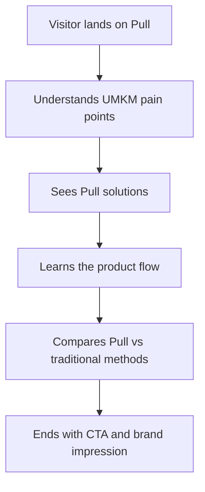

# Pull — UMKM Experience Landing Page

A cinematic landing page for **Pull**, a platform concept built to help Indonesian UMKM owners buy smarter, hire faster, and become visible in the digital market.

This project turns a practical product idea into an expressive scroll-driven web experience: pooled raw-material buying, informal job discovery, verified work history, public UMKM profiles, and QR-powered discovery — all presented through motion, layered visuals, and a modern editorial layout.



## ✨ What is Pull?

Pull is designed around three everyday problems faced by small businesses:

- **Raw materials are expensive** when bought individually in small quantities.
- **Finding daily workers is unreliable** when recruitment depends only on word of mouth.
- **Many UMKM are invisible online** because digital setup feels costly or complicated.

The landing page introduces Pull as one connected ecosystem where UMKM can:

- Join pooled purchases to access wholesale-style pricing.
- Post or apply for informal daily jobs.
- Build reputation through ratings, Trust Score, and PullPoints.
- Get a public business profile with an automatic QR code.

## 🚀 Features

- **Animated hero experience** with a premium startup-style presentation.
- **Smooth scrolling** powered by Lenis.
- **Scroll-triggered interactions** using GSAP and ScrollTrigger.
- **3D atmospheric backdrop** built with Three.js.
- **Responsive sections** for problems, solutions, user flow, comparison, and closing CTA.
- **Accessible reduced-motion handling** for users who prefer less animation.
- **Modern Vite + React architecture** with SCSS styling.

## 🛠 Tech Stack

| Layer | Tools |
| --- | --- |
| Framework | React 18 |
| Build tool | Vite |
| Styling | SCSS, custom design system |
| Motion | GSAP, ScrollTrigger, Lenis |
| 3D visuals | Three.js |
| Typography | Archivo + Manrope variable fonts |

## 📦 Getting Started

Clone the repository:

```bash
git clone https://github.com/stoy109/Pull-LandingPage.git
cd Pull-LandingPage
```

Install dependencies:

```bash
npm install
```

Start the development server:

```bash
npm run dev
```

Build for production:

```bash
npm run build
```

Preview the production build locally:

```bash
npm run preview
```

## 📁 Project Structure

```text
.
├── index.html
├── logo.svg
├── package.json
├── vite.config.js
└── src
    ├── App.jsx
    ├── main.jsx
    ├── styles.scss
    ├── components
    │   ├── BottomOverscroll.jsx
    │   ├── BrandMark.jsx
    │   ├── FlowSection.jsx
    │   ├── Graphics.jsx
    │   ├── Header.jsx
    │   ├── Sections.jsx
    │   └── ThreeBackdrop.jsx
    └── data
        └── content.js
```

## 🎯 Experience Flow



## 🌱 Core Product Story

Pull is not just a landing page concept — it presents a broader product vision:

1. **Fase Masuk**  
   Fast browser-based onboarding with email or Google login and WhatsApp OTP verification.

2. **Fase Transaksi**  
   UMKM can join buying pools, find jobs, apply for work, and negotiate safely via WhatsApp.

3. **Fase Penyelesaian**  
   Completed transactions update ratings, Trust Score, PullPoints, and public UMKM profiles.

## 📄 License

This repository currently does not include a license. Add one before using the project commercially or accepting outside contributions.

---

Built for a more connected, trusted, and visible UMKM ecosystem.
